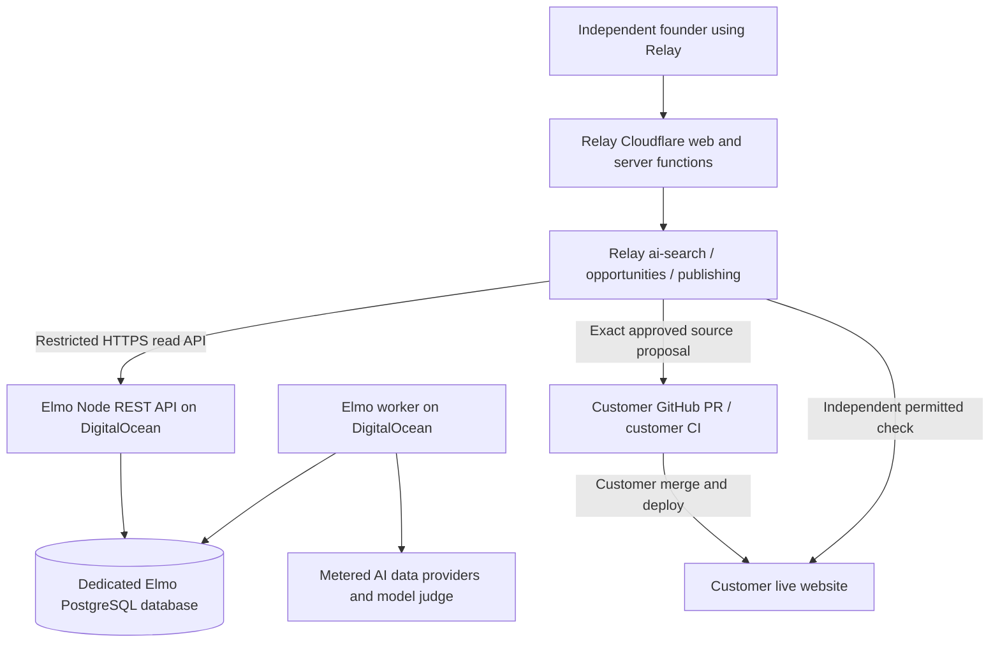

# Relay M20 — Elmo AI-search evidence integration and reviewed submodule updates

**Owner:** Playbook Media LLC · **Source code:** [PlaybookMediaLLC/elmo](https://github.com/PlaybookMediaLLC/elmo) · **Product:** [Relay](../../README.md)  
**Milestone:** [M20 — Elmo AI-search Evidence Service & Submodule Sync](https://github.com/PlaybookMediaLLC/relay/milestone/20)  
**Related growth release:** [M14 — AI-search opportunity to reviewed website action](https://github.com/PlaybookMediaLLC/relay/milestone/14) and [#268](https://github.com/PlaybookMediaLLC/relay/issues/268)  
**Status:** approved planning and GitHub issue breakdown. No deployment, API connection, real Elmo submodule or automatic source-update workflow is represented as completed by this document.

## Decision

**Keep Elmo as a separately deployed, pinned evidence service.** Use its REST API in Relay's existing AI-search and opportunity workflows. Elmo collects prompt-level consumer AI answers, citations, brand mentions, competitor results, available real query fan-out and later observations. Relay owns the end-user experience, permission checks, evidence-backed prioritization, founder decisions, reviewable source edits and technical/live verification.

**Also place the Playbook Elmo fork inside Relay as a Git submodule**, initially under `vendor/elmo`, to expose an exact reviewed source revision to maintainers and deployment automation. A submodule is **a reference to a commit**, not automatic source mirroring: `branch = main` in `.gitmodules` allows tracking the branch during explicit `git submodule update --remote` but cannot make gitlinks advance on its own.

To receive Elmo changes automatically **without silently importing untested code**, add a scheduled and manually dispatchable update workflow which fetches the fork's `main`, detects a changed gitlink, runs compatibility/safety checks and opens or refreshes a **single Relay pull request**. It is automated *discovery and proposed update*, not automatic merge, execution or deployment. The maintainer reviews the commit/contract changes and merges the pinned SHA when safe. See [#294](https://github.com/PlaybookMediaLLC/relay/issues/294).

No generalized Relay-owned GEO dashboard, second auth stack, external Elmo user account or direct Elmo-to-GitHub write path is authorized by this milestone.

## Why a separate M20 exists

[M13](https://github.com/PlaybookMediaLLC/relay/milestone/13) integrates the first existing-page acquisition opportunity, owner-approved GitHub PR and independently verified production result. [M14](https://github.com/PlaybookMediaLLC/relay/milestone/14) asks whether AI-search findings produce an additional credible founder action.

**M20 is the engineering integration contract for one evidence source**, not a new product-line ambition. It carries:
1. reproducible Elmo runtime/deployment and provider cost;
2. reviewed gitlink and automated source-update proposals;
3. secure read-only API and Relay project-to-brand mapping;
4. analysis-provenance, sampling and comparison with Relay's existing AI data;
5. conversion of qualified source evidence into the existing founder opportunity review;
6. upstream fork sync, compatibility, retention, rollback and spend gates.

The first buyer remains an independent software founder. Do not schedule M20 ahead of M13's source-edit proof or expand it into full AI-search competitor dashboards merely because the upstream UI makes that easy.

## What Elmo already implements and what Relay already owns

| Problem | Elmo fork has | Relay fork has | Boundary |
| --- | --- | --- | --- |
| Buyer-relevant AI prompts | Brand onboarding, competitor suggestions, tracked prompts and tags | Prompt Explorer, AI tracking research and founder project context | Elmo collects a scoped prompt sample; Relay chooses buyer intent and owns founder context |
| Answer observations | Configurable scraped/API AI providers, scheduled worker, raw answer storage, retry/analysis stages | DataForSEO AI observations, scheduled tracking and spend admission | Compare existing data first; do not pay twice for identical prompt sets |
| Brand and competitor judgments | Name/domain aliases, Jev-based mention/sentiment evidence, run-level records | Brand matching, citations, source-backed results and trends | Treat models, denominators and sampling as **non-equivalent** until normalized |
| Citation/source gaps | URL/domain categorization, competitor/third-party summaries and candidate opportunities | AI-search cited sources, general opportunities and ownership checks | Elmo suggests; Relay validates before showing an approved action |
| Query fan-out | Stores provider-exposed searches from supported consumer surfaces | Query/keyword research and prompt exploration | Distinguish **unavailable** from **zero actual searches**; no invented query strings |
| Source-controlled execution | No Relay-specific customer publishing contract | Exact-change approval, safe supported Next.js metadata/copy edits, GitHub PR, customer deployment and verification | Only Relay can request owner-approved execution |
| Customer outcome | Observed prompts/mentions/citations | GSC/GA4 acquisition observations, experiment/verification and founder history | AI citations are exposure observations, not causal signups or revenue |

Evidence sources: [Elmo provider registry](https://github.com/PlaybookMediaLLC/elmo/blob/main/packages/lib/src/providers/index.ts), [Elmo API routes](https://github.com/PlaybookMediaLLC/elmo/tree/main/apps/web/src/routes/api/v1), [Elmo worker](https://github.com/PlaybookMediaLLC/elmo/blob/main/apps/worker/src/jobs/process-prompt.ts), [Relay AI visibility](https://github.com/PlaybookMediaLLC/relay/tree/develop/src/server/features/ai-visibility), [Relay publishing](https://github.com/PlaybookMediaLLC/relay/tree/develop/src/server/features/publishing).

## Deployment and network design



Prefer **two App Platform components** from one approved, pinned Elmo commit: an API/web service and a worker. Use the upstream repository's distinct `docker/Dockerfile` targets (`web`, `worker`, `migrate`) only after confirming their behavior against the Playbook fork and selecting deployment commands. Postgres is mandatory for Elmo's `pg-boss` queue and application tables. Reuse an existing credited *PostgreSQL cluster* only with an isolated database, role and migrations. Do not point Elmo's migrations at Relay's D1 or its existing Postgres schema.

Relay operates on **Cloudflare Workers**. Cloudflare cannot directly reach an App Platform-only private hostname; use a tightly restricted public HTTPS endpoint or a vetted service-to-service networking arrangement. Expose only what Relay's backend requires. Elmo's dashboard remains an operational internal UI, not part of Relay customer onboarding.

### Pilot provider and billing boundaries

Elmo supports multiple scraping/API collection providers, including DataForSEO and Cloro. Relay already uses DataForSEO and OpenRouter. Pilot **DataForSEO + a direct structured research model + Jev via OpenRouter or TypeSafe**, with a small defined prompt/engine set; benchmark Cloro only if its additional consumer observations or query fan-out make an actionable difference.

Track raw request attempts, provider charges, scheduled collection and missed samples, model judge cost, compute, stored answers and repeat collection. A provider account being prepaid or covered by credits does not make marginal work cost zero. Initial scope can be 10–20 buyer-qualified prompts on one Playbook-owned site, with a daily or otherwise explicitly budgeted cadence; exact settings are experimentation choices, not commercial quotas.

Do not assume Elmo's cloud billing, Auth0 white-label SSO, Resend, Cloro, another Redis or bundled UI are required for an internal self-hosted pilot. Review Elmo env mode validation and actual code before deployment.

**Owned execution receipts:** one pinned image/build SHA, successful migrations, API health, correct auth, a real scheduled sample, durable stored results, visible worker failure and a documented last-known-good rollback (including migration compatibility). See [#295](https://github.com/PlaybookMediaLLC/relay/issues/295).

## Git submodule and upstream update mechanics

There are **two distinct repositories moving at different times**:

```text
elmohq/elmo main                          [original upstream]
        │ upstream sync PR + review
        ▼
PlaybookMediaLLC/elmo main                [our fork / deployed source]
        │ detected by scheduled/dispatched Relay updater
        ▼
PlaybookMediaLLC/relay vendor/elmo        [gitlink pinned to one fork commit]
        │ generated PR + contract tests + human review/merge
        ▼
Relay develop                             [approved pointer, never floating main]
```

### Submodule setup contract (issue #294)

Execute on a real checkout of Relay's `develop` branch in a scoped implementation PR, not by copying Elmo's files manually:

```bash
git submodule add -b main https://github.com/PlaybookMediaLLC/elmo.git vendor/elmo
git add .gitmodules vendor/elmo
git commit -m "chore: track Playbook Elmo source as git submodule"
```

The resulting commit needs:
- `.gitmodules` entry with `path = vendor/elmo`, URL `https://github.com/PlaybookMediaLLC/elmo.git` and `branch = main`;
- an **actual Git tree entry of mode `160000`** at `vendor/elmo` with the intended fork commit SHA, not a nested full directory;
- fresh-clone guidance: `git submodule update --init --recursive`, plus no-submodules/sparse-checkout behavior for Relay's normal lightweight Cloudflare build;
- MIT license attribution kept in the Elmo checkout and any redistributed binary artifacts.

**The `branch = main` metadata does not make commits move automatically.** Git records the exact fork SHA. `git submodule update --remote vendor/elmo` changes the checkout's pointer locally; it must be committed to Relay to affect collaborators or deployments.

### Automatic update-PR bot (issue #294)

Implement a GitHub Actions workflow in Relay, initially **scheduled daily** and `workflow_dispatch`. An optional later `repository_dispatch` from the Playbook Elmo repo can speed up detection but requires an explicitly approved cross-repo credential. On each run:

1. Check out the trusted Relay base branch, including pinned submodules where appropriate; use the configured approved Playbook fork `main`.
2. Fetch the new fork head, compare with Relay's recorded `160000` gitlink. If identical, do nothing.
3. When changed, construct **one** bounded update branch/PR (e.g. `chore/update-elmo-gitlink`) containing only the changed gitlink and, if necessary, an explicitly reviewed compatibility change. Avoid a PR on every poll.
4. Include old/new commit IDs, compare URL, key dependency/manifest/provider/auth and DB migration changes, supply-chain/license review and any external API breaking changes.
5. Run the integration contract tests and dependency/license checks. **A PR opened by the default `GITHUB_TOKEN` may not trigger normal `pull_request` workflow runs; do not imply CI passed because the PR exists.** Run verification before proposing and establish a supported GitHub App/PAT or explicitly dispatched check for required PR CI.
6. Require manual approval and a passing release compatibility gate before merging to `develop`; no automatic production deploy of unreviewed Elmo code. A failed check leaves a visible blocked PR. Roll back by restoring a known-good gitlink and matching API/worker build.

**Upstream fork sync (issue #299):** `PlaybookMediaLLC/elmo` is a fork of `elmohq/elmo`. New commits in the original `elmohq/elmo` do not update the Playbook fork automatically. Add a separate reviewed fork-sync job/PR or use explicit manual merge when upstream changes. Never force reset Playbook `main` or silently overwrite custom modifications.

**Safety boundary:** the Elmo submodule is an inspectable source/deployment reference. Relay's Cloudflare application must not execute `vendor/elmo` as a build-time dependency, import Elmo's Node/postgres runtime or automatically upgrade the live Elmo service from `main`.

## Read-only REST integration contract

Use **Elmo REST API** for routine server-to-server requests and retain MCP for developer investigation. The fork already implements versioned endpoints and scoped bearer-key access. Use one separate Elmo organization/brand for the test and a read-only organization key restricted to its brand where supported.

| Elmo REST endpoint | What Relay consumes | Constraints |
| --- | --- | --- |
| `GET /api/v1/me` | Validate org, brand restriction and read-only key capabilities | A key with `admin` reach must not be used by the normal Relay integration |
| `GET /api/v1/brands/{brandId}/analytics` | Visibility and competitive summary | Requires explicit `start`, `end` ISO timestamps; metrics are provider- and method-specific |
| `GET /api/v1/brands/{brandId}/prompt-performance` | Prompt-level gap and run coverage | Never invent absent buyer demand |
| `GET /api/v1/brands/{brandId}/citations/urls` | Cited pages and their source categories | Paginate and retain URL/source provenance |
| `GET /api/v1/brands/{brandId}/query-fanout` | Actual reported web search strings | Provider may not expose them; unavailable ≠ zero |
| `GET /api/v1/brands/{brandId}/opportunities` | Generated suggestions to investigate | Read-only cached report; not authorization to generate arbitrary code |
| `GET /api/v1/prompts/{promptId}/runs/{runId}` | On-demand full answer and citation evidence | Explicit brand-to-prompt authorization and limited raw response access |

Elmo's analytics endpoints use **half-open UTC windows**, `[start, end)`, and align to their stored time buckets. Keep both ISO timestamps, actual returned range, model/provider, relevant prompts and source timestamps in the normalized observation. Do not truncate windows to local bare calendar dates or silently average incomplete samples.

Relay implementation owner: existing `src/server/features/ai-search/services` and `ai-visibility`; follow existing server-function → service → repository architecture. Implement a **typed, Zod-validated, server-only HTTP client** and minimal project↔Elmo org/brand configuration. Provider keys and Elmo bearer keys must never enter browser bundles, client events, prompts or issue logs. Access must be scoped against Relay project/org identity **before** looking up the Elmo mapping. Test forbidden brand reads, missing/expired key, 401/403/429/5xx, retries, pagination, absent metrics, stale data and invalid payloads. Reuse Relay caches and rate limits if available.

**Storage rule:** Elmo owns raw answers and most analytic rollups; Relay stores small normalized evidence references, accepted decisions and work/verification receipts. Do not duplicate Elmo's complete data model or build a second AI-dashboard under Relay. See [#296](https://github.com/PlaybookMediaLLC/relay/issues/296).

## Normalized evidence and one useful founder action

An Elmo observation must be **inspectable**: Relay project/tenant, source provider, Elmo brand ID, prompt text/ID, engine and access type, model/version, market/language, collection time, sampling window, number expected/completed/failed, citation URLs and categories, brand/competitor detection version and any actual exposed query fan-out. Analysis and provider outputs are untrusted source data, not instructions.

**Comparison gate:** run a bounded baseline on one authorized Playbook website alongside Relay's existing DataForSEO-based AI tracking, with overlap small enough to control provider spend. Report differences in denominators, collected surface, scope, stale/unknown states, citation coverage, cost and newly actionable evidence. Stop or narrow if Elmo produces only another similar dashboard without decisions worth completing. See [#297](https://github.com/PlaybookMediaLLC/relay/issues/297).

**Opportunity gate:** a founder-facing AI-search gap should include a relevant buyer prompt, actual answer/citation evidence, plausible audience value, related existing owned page, a supported proposed website action (or an ethical off-site task/no-action), owner approval, source revision and expected technical postcondition. Route website work through Relay's existing exact-diff GitHub controls, customer deployment and independent live result. External editorial citations are not pages the founder can modify; no fake reviews, Wikipedia self-editing, mass forum placement, or guarantee of AI citation gain. See [#298](https://github.com/PlaybookMediaLLC/relay/issues/298).

The first completed M20 experiment is **not** "Elmo dashboard loaded." It is a correct Elmo-sourced evidence set in Relay leading to one justified action or a defensible no-action, with cost and verification known. M14 is where that can progress to a genuine customer acquisition workflow.

## Execution and exit gates

| Order | Tracking issue | Gate |
| --- | --- | --- |
| **P0** | [#294 — Submodule and automatic update PRs](https://github.com/PlaybookMediaLLC/relay/issues/294) | Real `.gitmodules` + mode 160000 gitlink, scheduled coalescing PR, reviewed SHA promotion |
| **P0** | [#295 — Elmo deployment](https://github.com/PlaybookMediaLLC/relay/issues/295) | Pinned, healthy API/worker/DB with migrations and measured provider cost |
| **P0** | [#296 — Scoped read-only client](https://github.com/PlaybookMediaLLC/relay/issues/296) | Relay project reads only its authorized Elmo org/brand, API failures handled |
| **P1** | [#297 — Compare observation quality](https://github.com/PlaybookMediaLLC/relay/issues/297) | Same buyer prompts, comparable samples and source/provider costs; additional signal established or honestly rejected |
| **P1** | [#298 — Actionable opportunity](https://github.com/PlaybookMediaLLC/relay/issues/298) | Evidence becomes owner-reviewed action or justified no-action; actual website change uses M13 protections |
| **P1** | [#299 — Upstream fork sync and rollback](https://github.com/PlaybookMediaLLC/relay/issues/299) | Upstream and fork update PRs work with license/schema/compatibility checks and SHA recovery |
| **P2** | [#300 — Security and retention](https://github.com/PlaybookMediaLLC/relay/issues/300) | Tenant, brand, provider, data retention and attribution boundaries verified before external customer use |

**No new release commitment or due date is implied.** Prefer a small internal test before enabling any new customer-visible UI or advertising AEO outcomes. Elmo remains MIT-licensed; preserve [its upstream copyright notice](https://github.com/PlaybookMediaLLC/elmo/blob/main/LICENSE.md).

### Decision at milestone exit

Keep the Elmo service only if it reliably produces **additional defensible acquisition work** for founders, can be deployed and upgraded without silent API drift, and has predictable provider/compute/support economics. Otherwise preserve useful parser/evidence insights and leave the general AI-search workflow on Relay's existing DataForSEO sources.
