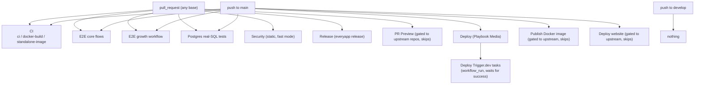
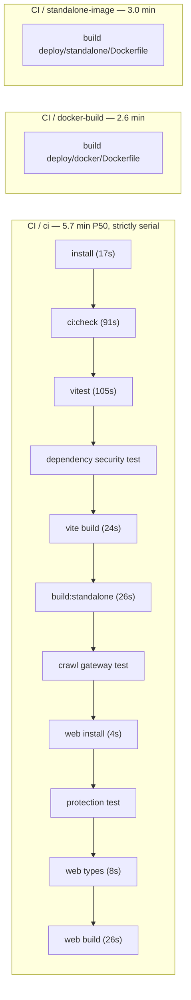
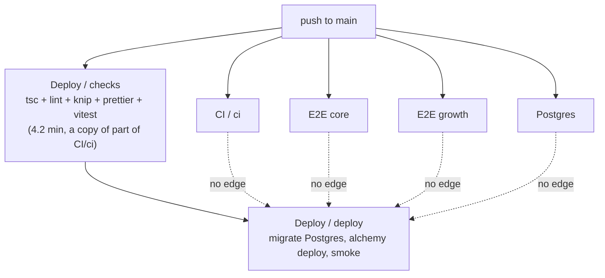

# Current architecture

What ran before this work, on which trigger, and what actually gated
production. Measurements are in [baseline.md](baseline.md).

## Branches

`develop` is the default branch. Work lands there by pull request, and
`develop` is merged into `main` to release.

| Branch    | Ruleset               | Required status checks | Approvals |
| --------- | --------------------- | ---------------------- | --------- |
| `develop` | `develop branch flow` | **none**               | 0         |
| `main`    | `main branch flow`    | `ci`, `e2e-growth`     | 0         |

`main`'s ruleset sets `strict_required_status_checks_policy: false` and allows
only merge commits. A merge therefore creates a SHA that no check has run on,
and that SHA is what `deploy-playbook.yml` deploys.

`ci.yml` triggers on `pull_request` (any base) and `push` to `main`. **A push
to `develop` runs no CI at all** — a direct push, or a merge whose pull request
checks were red, lands unverified.

`ci.yml` also checks out `github.event.pull_request.head.sha`, not the merge
commit, so a change that conflicts semantically with the base branch is never
validated against it.

## Triggers

## The CI workflow

One serial job plus two image builds:

Three properties of this shape cost time:

1. **Nothing starts until the thing before it finishes.** A formatting error
   is reported after 108 s even though it is known at 20 s.
2. **A failing unit test hides the builds.** `set -e` ends the job, so a run
   reports one problem per attempt.
3. **The two image builds run unconditionally**, on every pull request,
   whatever changed. `deploy/docker/Dockerfile` does not even compile the
   application — it installs dependencies and builds at container start — so
   on a typical `src/` change its 2.6 min proves nothing new.

## What gated production

The dotted edges do not exist. The deploy's only gate was its own `checks`
job, which runs a **subset** of `CI / ci`: it skips the eager-bundle guard,
the standalone build, the crawl-gateway test, the website checks and the
dependency security test — and of course it has no browser or Postgres
coverage at all.

See [baseline.md](baseline.md#deployment-gating) for the run that deployed
while CI and the core E2E suite were still running.

## Deploy stage detail

`deploy-playbook.yml`, stage `playbook`, `https://relay.playbookmedia.io`:

1. `checks` job — install, `tsc && lint && knip && prettier`, `vitest`. 4.2 min.
2. `deploy` job:
   - write `.env.playbook` from the `ENV_PLAYBOOK` secret plus repository variables;
   - validate the configuration (domain, auth mode, secret lengths) before spending a build;
   - `pnpm db:migrate:pg` against the production Postgres;
   - `pnpm build:report-widgets && vite build --mode playbook && alchemy deploy`;
   - verify the deployment answers and is protected;
   - smoke-test the public site;
   - `rm -f .env.playbook`.

`concurrency: deploy-playbook`, `cancel-in-progress: false` — two deploys never
overlap and one is never interrupted mid-migration. That is correct and is kept.

`trigger-deploy-playbook.yml` then deploys the Trigger.dev tasks on
`workflow_run` success, checking out `workflow_run.head_sha` so the tasks match
the Worker that shipped. Also correct, and kept.

## Inherited workflows

| Workflow                     | Status on this fork                                                                                  |
| ---------------------------- | ---------------------------------------------------------------------------------------------------- |
| `pr-preview.yml`             | Inert. Gated to `bensenescu/open-seo` and `every-app/private-open-seo`. 397 skipped runs in 11 days. |
| `docker-image.yml`           | Inert. Gated to `every-app/open-seo`. Publishes `ghcr.io/every-app/*`.                               |
| `deploy-production.yml`      | Inert. Deploys `app.openseo.so`, upstream's hosted product.                                          |
| `deploy-website.yml`         | Inert. Deploys `openseo.so`, upstream's marketing site.                                              |
| `release.yml`                | **Active, ungated.** Runs a full `everyapp release` build on every pull request.                     |
| `upstream-sync-playbook.yml` | Active and correct. Merges upstream on the 1st and 15th.                                             |
| `uptime-playbook.yml`        | Active and correct. 15-minute probe of three paths.                                                  |
| `security.yml`               | Active. Red on ~40% of pull requests, and not a required check.                                      |

The inert four are kept: deleting them would make the fortnightly upstream
merge conflict on every one of them, and their repository gates are exactly the
mechanism that keeps the synced copies harmless. They cost no runner time.

`release.yml` is the odd one out: it has no repository gate, and Relay ships
through Alchemy rather than `everyapp install`.
