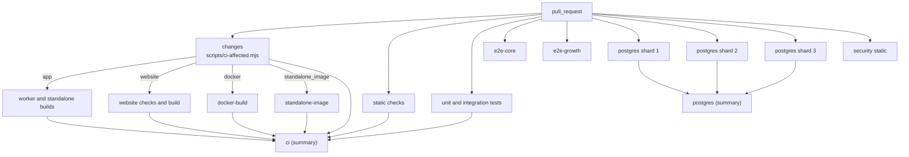
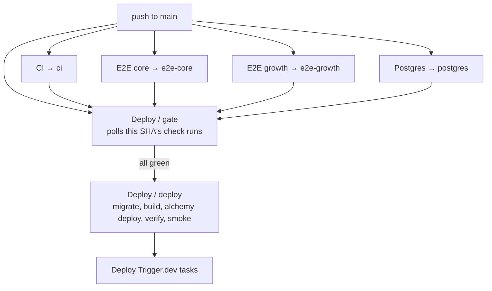

# Target architecture

The pipeline this change implements, and the parts of it that are still
proposals. Measured results: [benchmark-results.md](benchmark-results.md).

## Principle

Two rules decide the shape:

1. **Nothing waits for work it does not need.** Independent checks run at the
   same time; a job only depends on another when it consumes its output.
2. **Nothing reaches production that has not been checked, on that exact
   commit.** The gate gets stricter even where the pipeline gets faster. The
   deploy stops repeating checks not by trusting less, but by waiting for the
   checks that already ran on the SHA it is about to ship.

## Pull-request graph



Everything on the first level starts at once. The only serialization left is
`changes` (about 10 s) in front of the four selectable build jobs, which is the
price of knowing what to skip.

## The summary jobs

`ci` and `postgres` are jobs that run no work. They exist because a job that
GitHub skips reports no status check at all, so a conditional job cannot be a
required context, and a matrix job reports one context per shard rather than
one for the set.

Both collapse their dependencies into a single context:

- A dependency that **succeeded** or was **skipped** is fine. Skipped is the
  expected result for a job this change did not select.
- Anything else — failure, cancelled, timed out — fails the summary.

Their job ids are deliberately `ci` and `postgres`, matching the contexts
branch protection and the deploy gate already use. **Renaming either job
breaks merges into `main` silently**, because a required context that never
reports blocks the pull request forever.

## Affected-component selection

`scripts/ci-affected.mjs` maps the files a pull request changes, against its
merge base, onto four flags. The rules are a short, ordered, commented list in
that file; the unit test beside it pins the behaviour that matters.

| Flag               | Selects                      | Trigger paths                                                                                                                                                                |
| ------------------ | ---------------------------- | ---------------------------------------------------------------------------------------------------------------------------------------------------------------------------- |
| `app`              | worker and standalone builds | anything that is not prose or agent instructions                                                                                                                             |
| `website`          | website checks and build     | `web/`, `content/`, `src/shared/`                                                                                                                                            |
| `docker`           | self-host image build        | `deploy/docker/`, `package.json`, `pnpm-lock.yaml`, `pnpm-workspace.yaml`, `patches/`, `.npmrc`, `.nvmrc`                                                                    |
| `standalone_image` | standalone image build       | the `docker` set, plus `deploy/standalone/`, `scripts/celld/`, `src/standalone-server.ts`, `wrangler.standalone.json`, `vite.config.ts`, `vite-plugin-lean-worker-bundle.ts` |

Three rules keep this conservative:

- **The static checks and the unit suite are not selectable.** They are the
  checks most likely to catch a cross-cutting break, and at one to two minutes
  each in parallel they are not worth the risk. No test is skipped because its
  own file did not change.
- **An unmapped path turns everything on.** A new top-level directory, or a
  diff that cannot be computed, runs the full set.
- **A push to `main` is never narrowed.** The commit being deployed always gets
  everything.

Every run prints its decision and its reason to the run summary:

```
### Selected CI jobs (11 changed files)

| Job | Runs | Why |
| --- | --- | --- |
| `app` | yes | 11 files, including .github/workflows/ci.yml |
| `website` | yes | 1 file, including .github/workflows/ci.yml |
```

`web/` imports only `src/shared/` from the product (`AGENTS.md`,
"Boundaries"), which is why a change under `src/server/` does not rebuild the
website, while a change under `src/shared/` does.

## The deploy gate



The gate polls
`GET /repos/{owner}/{repo}/commits/{sha}/check-runs` every 15 s, which returns
the latest run per check name, so a re-run replaces its earlier result.

| Situation                            | Result                                           |
| ------------------------------------ | ------------------------------------------------ |
| All four green                       | Deploy proceeds                                  |
| Any failure, cancellation or timeout | Fails immediately, naming the check              |
| A check has not started yet          | Keeps waiting                                    |
| 25 minutes elapse                    | Fails, naming what it was waiting for            |
| The commit has no check runs at all  | `gh api` errors, the step fails, nothing deploys |

Every unknown fails closed. The one way past it is the
`deploy_without_checks` dispatch input, which logs a warning and writes to the
run summary.

A cancelled check is treated as a failure. On two merges in quick succession,
the older commit's E2E runs are cancelled by their own `cancel-in-progress`
concurrency, so the older deploy fails at the gate and the newer one ships —
which is what should happen, though the failed run is noise worth watching.

`concurrency: deploy-playbook` with `cancel-in-progress: false` is unchanged.
A deploy is still never interrupted mid-migration, and two never overlap.

## Why the deploy still builds its own artifact

The obvious next step — build once in CI, deploy that artifact — is
deliberately not taken.

`vite build --mode playbook` inlines values from `.env.playbook`
(`CUSTOM_DOMAIN`, `AUTH_MODE`, the PostHog and Turnstile public keys) into the
client bundle. The artifact is stage-specific, so CI cannot produce it without
the `ENV_PLAYBOOK` secret — and `ci.yml` runs on `pull_request`, including one
day from forks. Giving a pull-request-triggered workflow the production
environment's secrets to save 58 seconds is a bad trade, and it is exactly the
"unsafe cache reuse between untrusted PRs and privileged deployment contexts"
to avoid.

The build is 58 s of a 6-minute path. The duplication worth removing was the
4.2-minute `checks` job, and that is gone.

## Caches

| Cache         | Key                                                                         | Correctness argument                                                                                                    |
| ------------- | --------------------------------------------------------------------------- | ----------------------------------------------------------------------------------------------------------------------- |
| pnpm store    | lockfile hash (`setup-node`)                                                | Content-addressed store                                                                                                 |
| Prettier      | `prettier-<os>-<lockfile>-<sha>`, prefix restore                            | Prettier's cache keys on file content and resolved options, so a restored entry can only turn a pass into a faster pass |
| Chromium      | `playwright-<os>-<exact version>-chromium`                                  | A browser upgrade changes the version and re-downloads                                                                  |
| Local D1      | `d1-local-<os>-<hash of drizzle/sqlite/**, wrangler.jsonc, pnpm-lock.yaml>` | Pure function of the migrations and the binding                                                                         |
| Docker buildx | `type=gha`, scoped per image                                                | Layer digests                                                                                                           |

The D1 cache is **saved immediately after the migration, before the specs
run**, using `actions/cache/restore` and `actions/cache/save` rather than the
combined action. The specs write projects and tracked domains into that
database; a cache saved at the end of the job would hand one run's rows to the
next and change what it sees.

No cache crosses a trust boundary: every one is derived from files in the
commit, and none is written by a deployment context and read by a
pull-request context.

## Still proposals

| Change                                                                            | Why it is not done here                                                                               |
| --------------------------------------------------------------------------------- | ----------------------------------------------------------------------------------------------------- |
| Required status checks on `develop`                                               | A repository settings change; needs the maintainer                                                    |
| `ci-complete` style contexts added to the `main` ruleset (`e2e-core`, `postgres`) | Same                                                                                                  |
| Running the MCP tenant-isolation and free-tool browser suites in CI               | Needs a cost measurement first ([playwright-optimization.md](playwright-optimization.md))             |
| Parallel workers inside the core E2E suite                                        | Needs adversarial repeat runs to prove test-data isolation                                            |
| Fixing or demoting the security scan's 40% failure rate                           | Separate investigation; it is a correctness question, not a performance one                           |
| Preview deployments for this fork                                                 | [implementation-roadmap.md](implementation-roadmap.md) has the design and the open security questions |
