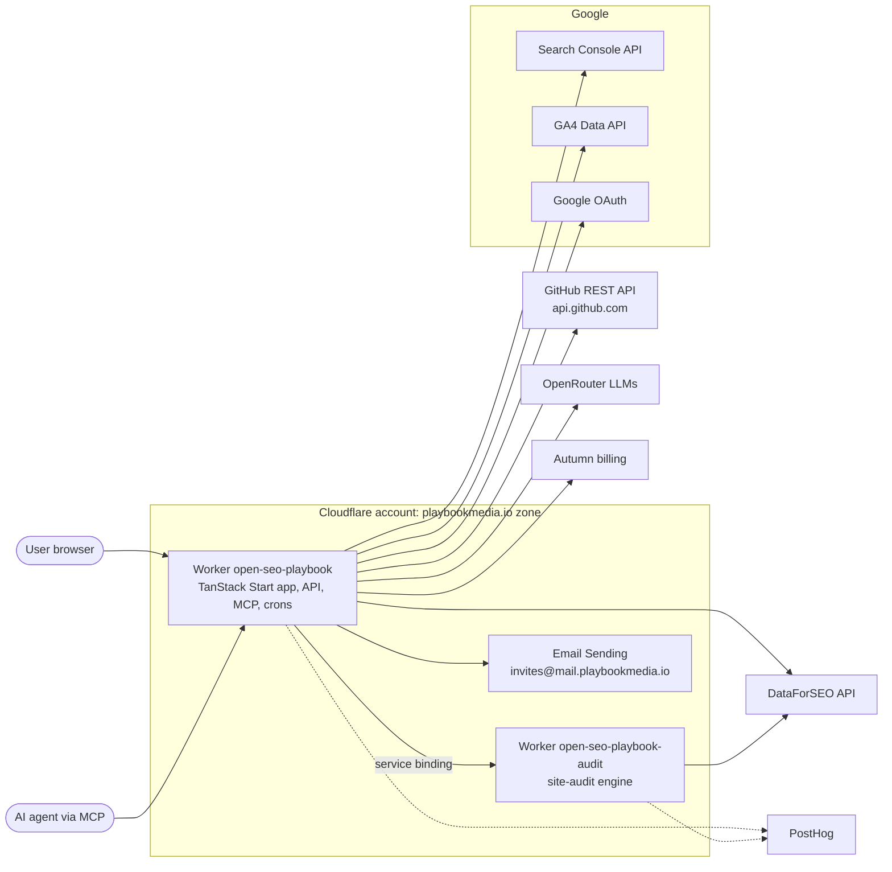
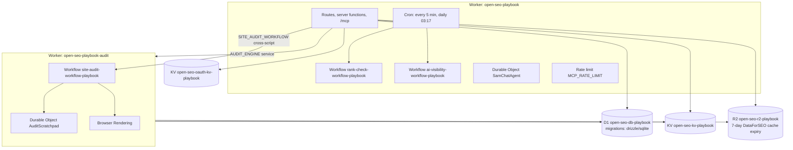
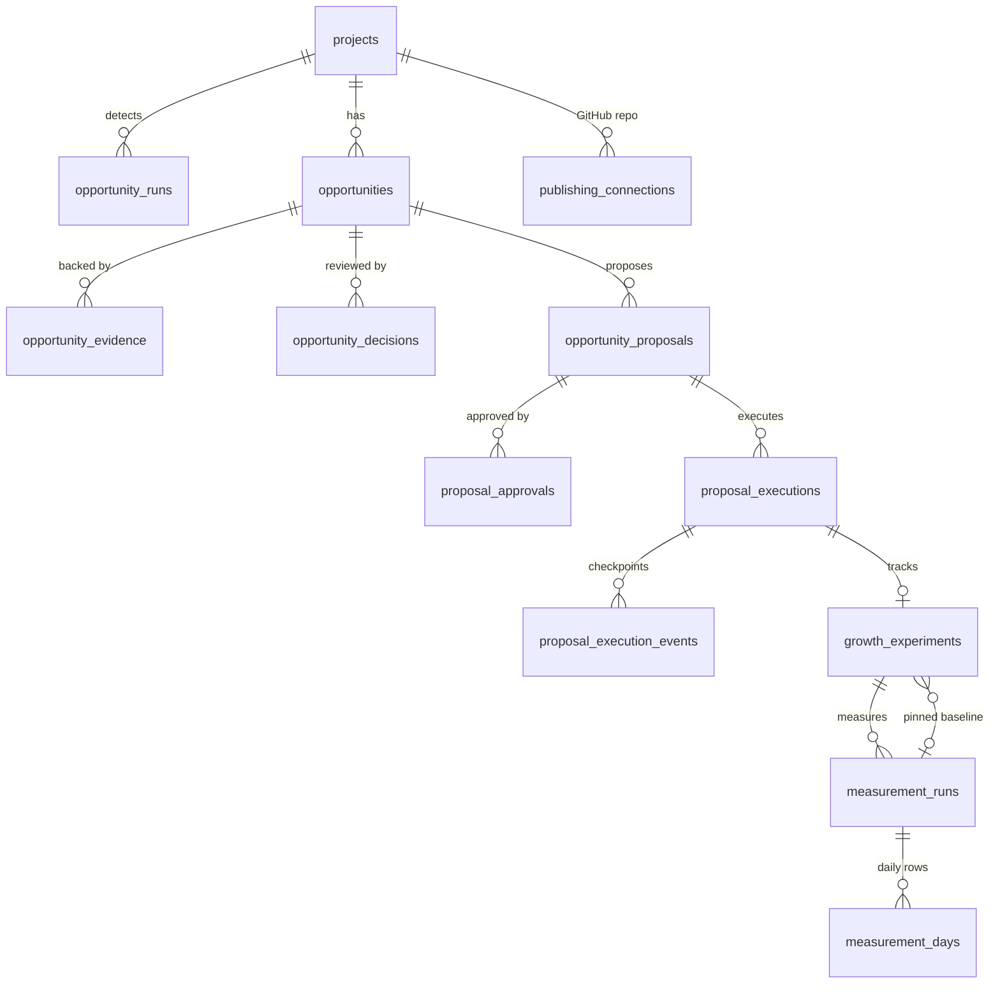
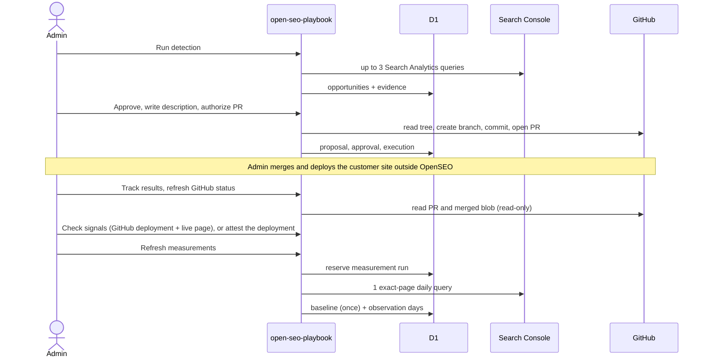
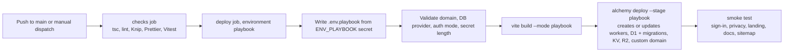

# Playbook Media deployment architecture

This note explains how the PlaybookMediaLLC fork of OpenSEO runs at `https://relay.playbookmedia.io`, what it depends on, and how it gets deployed. It is for engineers who maintain the deployment. User-facing behaviour is documented in `docs/`.

## Summary

- **Code:** `PlaybookMediaLLC/open-seo` is an upstream-tracking fork of `every-app/open-seo`. The MIT license and upstream notices are preserved. Pull upstream changes into `main` periodically.
- **Runtime:** two Cloudflare Workers, deployed by the repository's existing Alchemy stack (`deploy/alchemy/alchemy.run.ts`) as stage `playbook`.
- **Data:** a dedicated D1 database `open-seo-db-playbook`, plus stage-suffixed KV, R2, Workflows and Durable Objects. Nothing is shared with openseo.so, previews or any other stage.
- **Hostname:** `relay.playbookmedia.io` is bound as a Worker custom domain on the `playbookmedia.io` zone. The workers.dev URL is disabled.
- **Access:** public, `AUTH_MODE=hosted` with Google-only sign-in. Each user gets their own organization. Switching back to `cloudflare_access` re-creates an email-gated Access application.
- **Deploys:** `.github/workflows/deploy-playbook.yml` runs on every push to `main` and on manual dispatch. It runs checks, builds, deploys, applies D1 migrations, then runs a smoke test of the public site.

## Current status

`https://relay.playbookmedia.io` is public. It runs `AUTH_MODE=hosted` with `AUTH_GOOGLE_ONLY=true`: anyone can sign up and sign in with Google, and the email/password sign-in, sign-up and reset endpoints are disabled server-side. The product is branded **Relay** (see [Relay brand](#relay-brand)). `/privacy` and `/terms` are public Playbook Media LLC pages under Delaware law, with contact `team@playbookmedia.io`. `/` is a public, dark marketing landing page modelled on superwhisper.com: a floating pill nav, a sky hero that shrinks into a framed desktop showing the product, feature cards, pricing and an FAQ. It has no GitHub or self-hosting links. Signed-in users land on `/app`, which opens their last project, and every sign-in redirect defaults there. Inside the app the shell is a floating inset frame on a soft sidebar, and every page shares the `page-pad` gutter defined in `app.css`. Deploys run automatically from `main`. The verify step checks that the public privacy page and the landing page are served.

Google OAuth uses a Web client in project `playbook-openseo-prod` (organization solomon-ai.co). The consent screen is External and In production, with the app name `Relay`, the home, privacy and terms URLs and the authorized domain `playbookmedia.io`. Google shows the app name only after brand verification, which is not done yet. Brand verification needs the `playbookmedia.io` domain property in Search Console (owned by the owner's Google account, verified by a `google-site-verification` TXT record on the zone apex). The redirect URIs are `/api/auth/callback/google` (sign-in), `/api/gsc/oauth/callback` and `/api/ga4/oauth/callback` on `relay.playbookmedia.io`. The client ID and secret live only in `ENV_PLAYBOOK`.

Open items:

- **Google sensitive scopes:** Search Console (`webmasters.readonly`) and Analytics (`analytics.readonly`) are requested at connect time but not yet declared under Data Access. Users connecting them see Google's unverified-app warning, and the 100-user cap applies, until the scopes are declared and Google completes its sensitive-scope verification (days to weeks, with a demo video). Sign-in itself uses only basic profile scopes.
- **Billing:** Autumn (production) is connected by Stripe OAuth to the **playbookmedia.io** Stripe account. Pricing lives in `autumn.config.ts` and is applied with `AUTUMN_PROD_SECRET_KEY=... pnpm exec atmn --prod push --yes`. Free ($1 of credits a month) is assigned automatically; the Base Plan is $10 a month with $10 of credits; top-ups are $1 per 1,000 credits. An Autumn webhook sends `billing.updated` to `https://relay.playbookmedia.io/api/autumn/webhook`. Edit it in the Svix portal under Autumn's Developer, Webhooks page (Production environment). `AUTUMN_SECRET_KEY` and `AUTUMN_WEBHOOK_SECRET` live in `ENV_PLAYBOOK`.
- **Icons:** `@tabler/icons-react`. Every icon's default size and stroke come from `--icon-size` and `--icon-stroke` in `src/client/styles/app.css`. Use `icon-nav` and `icon-card` for Eigenn's 14px and 20px sizes.
- **DataForSEO:** pay-as-you-go account with API credentials (Base64 `login:password`) in `ENV_PLAYBOOK` as `DATAFORSEO_API_KEY`. Research stops when the prepaid balance reaches zero, until the deposit is topped up. Users are billed through Autumn credits at the 1.28x markup in `src/shared/billing.ts`.
- **Turnstile:** a widget exists for `relay.playbookmedia.io`. Its keys are in `ENV_PLAYBOOK`, but Google-only mode does not use them.

- **Old hostname:** `seo.playbookmedia.io` has a proxied placeholder A record (`192.0.2.1`) and a Cloudflare Single Redirect rule that sends every request to the same path and query on `relay.playbookmedia.io` with a 301.

## Relay brand

The upstream code says "OpenSEO". This fork ships the product as Relay without editing upstream files, so upstream merges stay clean:

- `vite-plugin-relay-brand.ts` rewrites "OpenSEO" to "Relay" in every project module (not `node_modules`) at dev and build time. It also sends `support@openseo.so`, `app.openseo.so`, upstream help, blog and pricing links, and `github.com/every-app/open-seo` to Playbook Media, the Relay docs and this fork. `scripts/vite-plugin-relay-brand.test.ts` covers it.
- Relay's product docs live in `content/docs` and are served at `/docs` with Fumadocs (`source.config.ts`, `vite-plugin-relay-docs.ts`, `src/routes/docs/$.tsx`). `pnpm install` generates `.source/` (the `postinstall` script). The skill pages are adapted from upstream's `web/content/docs/skills`.
- New API keys start with `relay_`; `/mcp` still accepts keys made before the rename (`oseo_`).
- Unit tests run without the plugin and keep upstream's strings.
- Static files skip the plugin. `src/public/site.webmanifest` and the icon PNGs carry the Relay name and mark directly, and `plugins/openseo/.mcp.json` points the agent plugin at this deployment.
- Seams are marked `// playbook-seam`. Audit them with `grep -rn playbook-seam vite.config.ts src deploy`.
- After an upstream merge, run `pnpm vite build` and confirm that `grep -rao OpenSEO dist` finds nothing.

Known gaps: the agent plugin and skill folders keep the name `openseo`, and the skill files mention OpenSEO in their text. `docs/` and `web/` are upstream content that this deployment does not serve.

## System context



This deployment runs `AUTH_MODE=hosted`, so the hosted integrations apply. Autumn handles billing (see [Current status](#current-status)). Team invitations go through Cloudflare Email Sending: the `EMAIL` binding sends from `invites@mail.playbookmedia.io`, a sending domain onboarded in Cloudflare Email Service (`src/server/email/relay-email.ts`). Loops sends product updates from `updates.playbookmedia.io` (Loops team "Playbook Media", list "Relay product updates"). The deploy reads its key from the `RELAY_LOOPS_API_KEY` secret and the list ID from the `RELAY_LOOPS_PRODUCT_UPDATES_LIST_ID` variable. Team invitations still go through the `EMAIL` binding, which takes precedence over Loops. Dub (referrals) is not configured. The Turnstile keys are set, but Google-only sign-in does not use them. OpenRouter (AI features) and PostHog keys are set in `ENV_PLAYBOOK`.

## Cloudflare resources and bindings



| Binding                               | Resource                     | Used for                                                                                            |
| ------------------------------------- | ---------------------------- | --------------------------------------------------------------------------------------------------- |
| `DB`                                  | D1 `open-seo-db-playbook`    | All application data, including opportunities, publishing proposals and executions, and experiments |
| `KV`                                  | `open-seo-kv-playbook`       | Caches and short-lived state                                                                        |
| `OAUTH_KV`                            | `open-seo-oauth-kv-playbook` | MCP OAuth provider state (hosted mode only)                                                         |
| `R2`                                  | `open-seo-r2-playbook`       | DataForSEO response cache, reports and audit artifacts                                              |
| `AUDIT_ENGINE`, `SITE_AUDIT_WORKFLOW` | audit worker                 | Site audits outside the app worker's memory budget                                                  |
| `SAM_CHAT`                            | Durable Object               | In-app agent chat sessions                                                                          |
| `EMAIL`                               | Cloudflare Email Sending     | Team invitation emails from `invites@mail.playbookmedia.io`                                         |

Resource names are derived from the stage name in `makeResources`. Changing the stage name creates a new, empty set of resources.

## Data model of the growth workflow

These tables live in D1 and are created by the drizzle SQLite migrations. Every row is scoped to a project, and every project belongs to an organization.



## Request flow: from opportunity to measured result



Every write in that flow is fenced by the project's `publishing:<projectId>` claim in `data_refresh_claims`. See `docs/maintainers/specs/approved-github-metadata.md` and `docs/maintainers/specs/search-outcome-measurement.md`.

## Deployment pipeline



Deploys never cancel each other, so a D1 migration is never interrupted midway. Alchemy keeps its state in the account's Cloudflare state store, which requires a one-time `pnpm alchemy cloudflare bootstrap`.

## One-time setup

1. **Cloudflare state store:** run `pnpm alchemy login` once, then `pnpm alchemy cloudflare bootstrap`, against the account that owns `playbookmedia.io` (`de345701e5dc7e14d3c079da3e637448`).
2. **API token:** create an account API token with these permissions:
   - Account: Workers Scripts, Workers KV Storage, D1, Workers R2 Storage, Access (Apps and Policies) — all Edit.
   - Account: Secrets Store **Write** (Alchemy reads its state-store token through an edge preview, which Read alone rejects), Account Settings Read, Workers Tail Read, Access: Organizations Read.
   - Zone `playbookmedia.io`: Zone Read, DNS Edit, Workers Routes Edit, SSL and Certificates Edit.
3. **Repository secrets** (Settings, Secrets and variables, Actions):
   - `CLOUDFLARE_API_TOKEN`: the token from step 2.
   - `CLOUDFLARE_ACCOUNT_ID`: the account ID from step 1.
   - `ENV_PLAYBOOK`: the filled-in contents of `deploy/.env.playbook.example`. Set `ACCESS_ALLOWED_EMAILS`, a `BETTER_AUTH_SECRET` generated with `openssl rand -base64 48`, `DATAFORSEO_API_KEY`, and the Google OAuth client.
4. **Google OAuth client:** add the authorized redirect URIs `https://relay.playbookmedia.io/api/gsc/oauth/callback` and `https://relay.playbookmedia.io/api/ga4/oauth/callback`.
5. **GitHub environment:** create an environment named `playbook` and optionally require reviewers to approve each production deploy.
6. Run the workflow manually (Actions, "Deploy (Playbook Media)", Run workflow). The first run creates every resource, and the custom domain's certificate can take a few minutes to issue.
7. **GitHub App (optional, RFC-0005 5.7):** create the "Relay SEO" app under the PlaybookMediaLLC organization.
   - Permissions: Metadata read, Contents read and write, Pull requests read and write, Deployments read, Checks read and write, Commit statuses read, Issues read and write. Nothing else.
   - Callback URL: `https://relay.playbookmedia.io/api/github/app/setup`. Turn on "Request user authorization (OAuth) during installation".
   - Webhook (RFC-0010 SEO checks in App mode): URL `https://relay.playbookmedia.io/api/github/app/webhook`, a secret from `openssl rand -hex 32`, and the "Deployment status" event. Add the secret as `GITHUB_APP_WEBHOOK_SECRET` to `ENV_PLAYBOOK`. Without it, the webhook answers 404.
   - GitHub issues the private key in PKCS#1 PEM. WebCrypto needs PKCS#8. Convert it once: `openssl pkcs8 -topk8 -nocrypt -in relay-seo.private-key.pem -out relay-seo.pkcs8.pem`.
   - Add `GITHUB_APP_ID`, `GITHUB_APP_SLUG`, `GITHUB_APP_CLIENT_ID`, `GITHUB_APP_CLIENT_SECRET` and `GITHUB_APP_PRIVATE_KEY` (the PKCS#8 PEM) to `ENV_PLAYBOOK`. `deploy/alchemy/relay-env.ts` passes them to the worker. Without them, only personal tokens are offered.

8. **Scheduled jobs (RFC-0008):** they run on the Worker's own five-minute cron by default, every 15 minutes, with no setup (`src/server/features/growth/cronScheduler.ts`). Set `GROWTH_JOBS_MODE=off` to stop them. To move them to Trigger.dev instead, create a Trigger.dev project with staging and production environments.
   - In Trigger.dev, set `RELAY_INTERNAL_URL` (`https://relay.playbookmedia.io`) and `GROWTH_JOBS_SECRET` (generate it with `openssl rand -hex 32`).
   - Add `GROWTH_JOBS_SECRET` and `TRIGGER_SECRET_KEY` (the production secret key) to `ENV_PLAYBOOK`. `GROWTH_JOBS_MODE` defaults to `trigger` when both are set.
   - Deploy the tasks with `TRIGGER_PROJECT_REF=<ref> pnpm dlx trigger.dev@4.6.4 deploy`. Configure an alert for failed runs to the team's email, and a monthly spend alert.
   - To rotate the secret, move the old value to `GROWTH_JOBS_SECRET_PREVIOUS` for one deploy, then remove it.

9. **Repository token key (RFC-0009 5.7):** repository tokens use `BETTER_AUTH_SECRET` until `PUBLISHING_TOKEN_KEY` is set. To start or rotate the key:
   1. Generate a key with `openssl rand -base64 48`.
   2. In `ENV_PLAYBOOK`, move the current `PUBLISHING_TOKEN_KEY` to `PUBLISHING_TOKEN_KEY_PREVIOUS` (leave it empty the first time).
   3. Set the new key as `PUBLISHING_TOKEN_KEY` and raise `PUBLISHING_TOKEN_KEY_VERSION` by 1 (start at 1).
   4. Deploy. Each connection re-encrypts its token with the new key the next time Relay uses it.
   5. After every active connection shows the new version, remove `PUBLISHING_TOKEN_KEY_PREVIOUS` and deploy again:

      ```sql
      SELECT token_key_version, count(*) FROM publishing_connections
      WHERE revoked_at IS NULL AND transport = 'pat' GROUP BY token_key_version;
      ```

   A token whose key is gone asks the member to reconnect the repository.

Keep `BETTER_AUTH_SECRET` stable. Changing it invalidates sessions and the stored GitHub publishing tokens, which must then be reconnected.

## Operating notes

- **Logs:** use the Workers Observability dashboard for `open-seo-playbook`, or run `pnpm alchemy tail` locally. To send traces and logs to Axiom, see [Axiom APM](runbooks/axiom-apm.md).
- **Database:** to query the database, run `wrangler d1 execute open-seo-db-playbook --remote --command "..."` with `CLOUDFLARE_ACCOUNT_ID` set. Migrations are applied only by the deploy; do not hand-edit `d1_migrations`.
- **Rollback:** redeploy an earlier commit with the workflow's manual dispatch. D1 migrations only move forward, so a code rollback across a schema change needs care. Use D1 Time Travel (`wrangler d1 time-travel restore`) to recover data.
- **Teardown:** run `pnpm alchemy destroy deploy/alchemy/alchemy.run.ts --env-file .env.playbook --stage playbook`. This deletes the D1 database and all other data for the stage.
- **Upstream sync (weekly):**
  1. Run `git fetch origin` and merge `origin/main` (every-app/open-seo) into this fork's `main`.
  2. Run the full check: `pnpm types:check && pnpm lint && pnpm exec knip && pnpm exec prettier --check . && pnpm test:ci`.
  3. Compare `grep -rn playbook-seam` with the seam list in `vite-plugin-relay-brand.ts`. Conflicts are most likely in `Sidebar.tsx`, `AppShell.tsx`, `ProjectSwitcher.tsx` and `src/routes/__root.tsx`.
  4. Upstream's `pr-preview.yml` and `docker-image.yml` are gated to other repositories and stay inactive here.
- **Smoke test and uptime:** each deploy ends with a smoke test of the public site (server-rendered pages, docs search, sitemap, `robots.txt`, favicon). `uptime-playbook.yml` checks `/api/health`, `/` and `/docs`. It is scheduled every 15 minutes, but GitHub runs it every 3 to 5 hours. A failed run emails the repository owner. PostHog also emails the owner hourly when production throws exceptions (insight "Exception count", alert "Relay production errors").
- **Scheduled jobs without Trigger.dev:** the Worker cron runs them by default. Another scheduler can call the internal endpoints instead: set `GROWTH_JOBS_SECRET` and `GROWTH_JOBS_MODE=trigger`, which turns the Worker cron off.
  1. Send `POST` with a JSON body of at most 64 KB.
  2. Set `x-relay-timestamp` to the current Unix time in seconds. The Worker refuses a timestamp more than 300 seconds from its clock.
  3. Set `x-relay-signature` to the hex HMAC-SHA256 of `{timestamp}.{body}`, keyed with `GROWTH_JOBS_SECRET`. Sign the exact bytes that you send.
  4. Call `/api/internal/growth/due` with `{}` every 15 minutes. For each item, call `/api/internal/growth/run` with the item plus `attempt` and `maxAttempts`. Retry on `503`; stop on `422`.
  5. Call `/api/internal/growth/retention` with `{}` once a day.
     Every failure answers `404`, with no reason. Audit follow-ups wait as queued rows until the next `due` call.
- **Failed credit settlements (RFC-0009):** the Worker cron (or the Trigger.dev task `spend-reconcile`, through `/api/internal/billing/reconcile`) retries failed Autumn settlements every 15 minutes. A row stops after 10 attempts. List the stopped rows:

  ```sql
  SELECT id, organization_id, project_id, feature, actual_credits, cost_usd, attempts, last_error, created_at
  FROM spend_ledger WHERE status = 'settle_failed' AND attempts >= 10 ORDER BY created_at;
  ```

  Charge each one by hand in Autumn, then set its `status` to `settled`.

- **Edge rules outside the code:** two Response Header Transform Rules on the `playbookmedia.io` zone (Rules, Transform Rules) apply to `relay.playbookmedia.io` only. The Alchemy deploy does not upload `_headers`, so these rules set the headers instead.
  - "Relay hashed assets: browser cache one year" sets `Cache-Control: public, max-age=31536000, immutable` on `/assets/*` 200 responses.
  - "Relay security headers" sets `Strict-Transport-Security` (no `includeSubDomains`), `X-Content-Type-Options`, `Referrer-Policy` and `Permissions-Policy`.
    Zone Cache Rules have no effect on Workers static assets; do not use them for this.

## Dependency inventory

| Dependency                                                                    | Direction    | Required                                                           | Configuration                                                                                                    |
| ----------------------------------------------------------------------------- | ------------ | ------------------------------------------------------------------ | ---------------------------------------------------------------------------------------------------------------- |
| Cloudflare Workers, D1, KV, R2, Workflows, Durable Objects, Browser Rendering | Runtime      | Yes                                                                | Alchemy stack, `CLOUDFLARE_*` secrets                                                                            |
| Cloudflare Access (Zero Trust)                                                | Inbound auth | Yes in `cloudflare_access` mode                                    | `ACCESS_ALLOWED_EMAILS`                                                                                          |
| Google OAuth, Search Console, GA4                                             | Outbound     | Required for opportunities and experiments                         | `GOOGLE_CLIENT_ID`, `GOOGLE_CLIENT_SECRET`                                                                       |
| GitHub REST API                                                               | Outbound     | Only for publishing proposals                                      | GitHub App `relay-seo` (`GITHUB_APP_*`), or a per-project fine-grained token encrypted with `BETTER_AUTH_SECRET` |
| DataForSEO                                                                    | Outbound     | Deploy requires the key; spends credits only for research features | `DATAFORSEO_API_KEY`                                                                                             |
| OpenRouter                                                                    | Outbound     | Optional, for AI features                                          | `OPENROUTER_API_KEY`, `OPENROUTER_MODEL`                                                                         |
| PostHog                                                                       | Outbound     | Optional                                                           | `POSTHOG_*`, `OPENSEO_TELEMETRY_DISABLED`                                                                        |
| Autumn                                                                        | Outbound     | Yes in `hosted` mode                                               | `AUTUMN_SECRET_KEY`, `AUTUMN_WEBHOOK_SECRET`                                                                     |
| Cloudflare Email Sending                                                      | Outbound     | Yes, for team invitations                                          | `EMAIL` binding, sending domain `mail.playbookmedia.io`                                                          |
| Loops, Dub                                                                    | Outbound     | Optional in `hosted` mode                                          | Loops: `RELAY_LOOPS_API_KEY` secret and `RELAY_LOOPS_PRODUCT_UPDATES_LIST_ID` variable. Dub: unset               |
| Turnstile                                                                     | Inbound      | Not used with Google-only sign-in                                  | `TURNSTILE_*` set, unused                                                                                        |
| Trigger.dev                                                                   | Scheduler    | Only for scheduled jobs                                            | `TRIGGER_SECRET_KEY`, `GROWTH_JOBS_SECRET`, `GROWTH_JOBS_MODE`                                                   |
| GitHub Actions                                                                | CI/CD        | Yes                                                                | `deploy-playbook.yml`, `ci.yml`                                                                                  |
| Alchemy state store                                                           | Deploy state | Yes                                                                | One-time bootstrap in the account                                                                                |

## Azure PostgreSQL

Playbook production uses the externally managed Hyperdrive configuration in the
`RELAY_HYPERDRIVE_ID` repository variable. Both the app and audit Worker bind it
as `HYPERDRIVE`. The deploy workflow sets `DATABASE_PROVIDER=postgres` and applies
PostgreSQL migrations with the `RELAY_POSTGRES_DATABASE_URL` repository secret.
Keep the migration URI secret. The former Playbook D1 database remains allocated
for rollback and receives no further SQLite migrations while PostgreSQL is active.

A separate infrastructure repository also owns the staging Hyperdrive configuration.
There is currently no separate Playbook staging Worker deployment.
